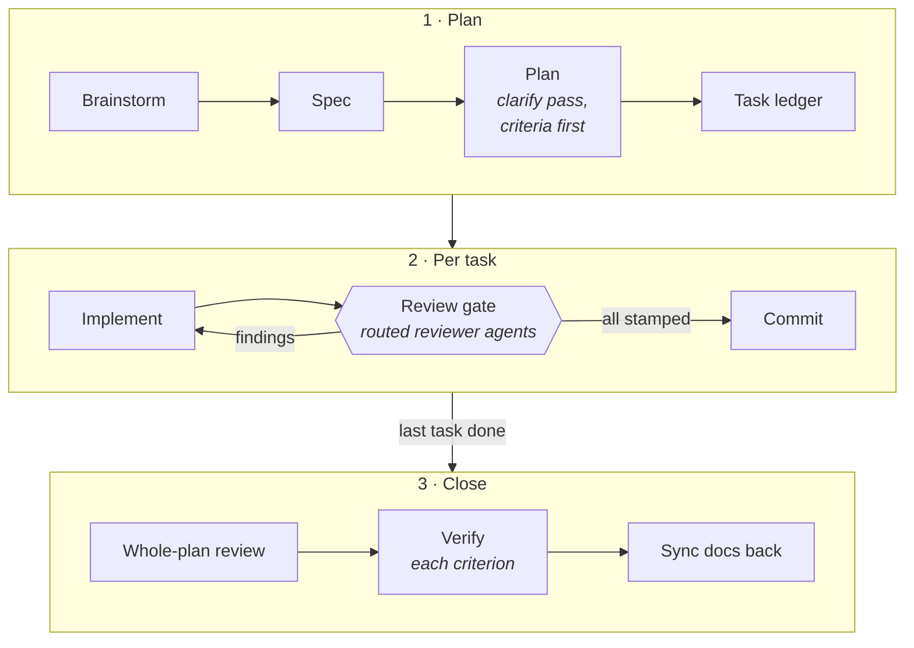

<p align="center">
  <picture>
    <source media="(prefers-color-scheme: dark)" srcset="docs/assets/logo-dark.svg">
    
  </picture>
</p>

<p align="center">
  <b>Spec-driven development for agentic coding.</b><br>
  Specs before plans, criteria before code, and reviewer agents that have to sign off before anything gets committed.
</p>

<p align="center">
  <a href="https://github.com/shaked-shlomo/ssdd/actions/workflows/test.yml"></a>
  <a href="https://github.com/shaked-shlomo/ssdd/tags"></a>
  <a href="LICENSE"></a>
  = 22">
  
  
</p>

---

SSDD is a portable framework you inject into a repo to keep AI agents (and
humans) on a disciplined process. It was extracted from a production project
with ~50 shipped plans and packages what made that project reliable:

- **Specs and plans first.** Every non-trivial change is a numbered plan with
  acceptance criteria written before any code.
- **A review gate on every commit.** Each staged file is routed to the
  reviewers that cover it (security, performance, resilience, docs-sync,
  conventions, your own domain lenses), and the commit is blocked until each
  one has reviewed that file's exact staged change.
- **Real verification.** Every acceptance criterion closes with command output
  from the session, never numbers from memory.
- **Docs move with the code.** Architecture maps and checklists update in the
  same commit as the change that invalidated them.

It works **whatever drives the work**: Claude Code, Cursor, Codex, or a human
in a terminal. The process and reviewers are plain markdown; the enforcement
is a zero-dependency Node script with a portable git-hook mode plus earlier
interception in agent harnesses.

## How it works



- **Where the work is.** `work-state.mjs` prints every open plan at session
  start, and the pre-commit hook checks a plan before it closes.
- **Production changes go one way.** `prod-guard.mjs` asks a person before
  anything else that would change production; stacks come as packs.
- **Onboarding.** `/migrate-plans` brings older plans to the format the view
  reads.

What's in the box, and how each part works: [docs/usage.md](docs/usage.md#how-it-works).
Full lifecycle: [process/SDD.md](process/SDD.md).

## Quick start

Requires Node ≥ 22 and git. Nothing to `npm install`.

```bash
git clone https://github.com/shaked-shlomo/ssdd ~/ssdd
node ~/ssdd/bin/ssdd.mjs install /path/to/project claude-code,cursor
```

Then fill in the per-project half (routing, the Documentation Map, domain
reviewers, `/skills-audit`): [docs/usage.md](docs/usage.md#setup).

## Updating an injected repo

`node ~/ssdd/bin/ssdd.mjs update <repo>` merges each framework file three ways
and keeps the project's edits: [docs/usage.md](docs/usage.md#updating-an-injected-repo).

## When a new model generation ships

Run `/doctor prompt-audit` and re-run a recent plan's task on the new model:
[docs/usage.md](docs/usage.md#when-a-new-model-generation-ships).

## Known limitations

The gate is not a sandbox: the hooks catch what a cooperating agent does by
mistake or habit, and the git pre-commit layer is the backstop for what they
can't see. Every limit: [docs/limitations.md](docs/limitations.md).

## Development

```bash
node --test mechanisms/hooks/*.selftest.mjs bin/*.selftest.mjs packs/*/*.selftest.mjs
```

Tests are named `*.selftest.mjs` so no injected project's test runner
collects them; CI runs them on Node 22 and 24. [SPEC.md](SPEC.md) indexes
SSDD's own design specs, one per version; remaining work is in
[docs/BACKLOG.md](docs/BACKLOG.md); releasing is in
[docs/usage.md](docs/usage.md#releasing).

## License

[MIT](LICENSE) © Shaked Shlomo
