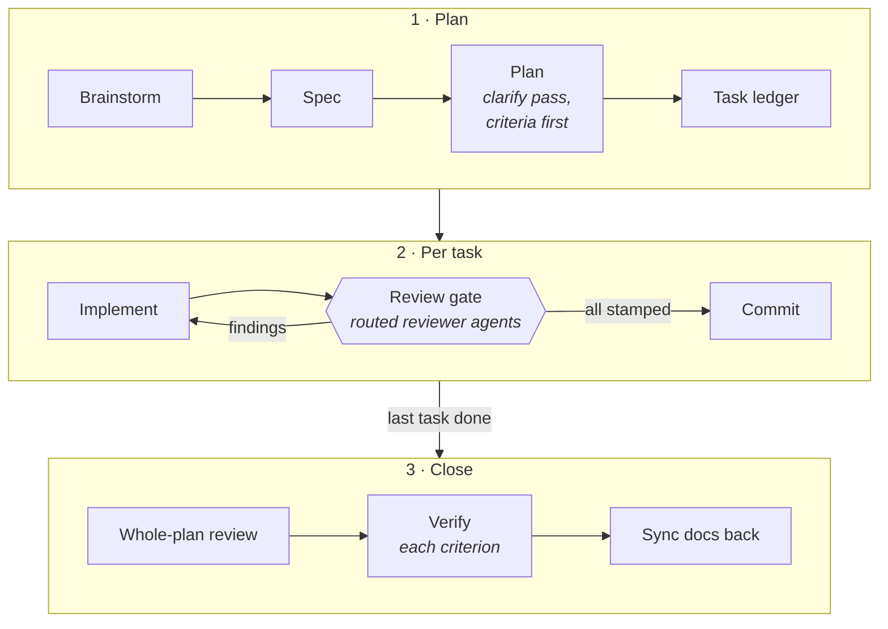

<p align="center">
  <picture>
    <source media="(prefers-color-scheme: dark)" srcset="docs/assets/logo-dark.svg">
    
  </picture>
</p>

<p align="center">
  <b>Spec-driven development for agentic coding.</b><br>
  Specs before plans, criteria before code, and reviewer agents that have to sign off before anything gets committed.
</p>

<p align="center">
  <a href="https://github.com/shaked-shlomo/ssdd/actions/workflows/test.yml"></a>
  <a href="https://github.com/shaked-shlomo/ssdd/tags"></a>
  <a href="LICENSE"></a>
  = 18">
  
  
</p>

---

SSDD is a portable framework you inject into a repo to keep AI agents (and
humans) on a disciplined process. It was extracted from a production project
with ~50 shipped plans and packages what made that project reliable:

- **Specs and plans first.** Every non-trivial change is a numbered plan with
  acceptance criteria written before any code.
- **A review gate on every commit.** Each staged file is routed to the
  reviewers that cover it (security, performance, resilience, docs-sync,
  conventions, your own domain lenses), and the commit is blocked until each
  one has reviewed that file's exact staged change.
- **Real verification.** Every acceptance criterion closes with command output
  from the session, never numbers from memory.
- **Docs move with the code.** Architecture maps and checklists update in the
  same commit as the change that invalidated them.

It works **whatever drives the work**: Claude Code, Cursor, Codex, or a human
in a terminal. The process and reviewers are plain markdown; the enforcement
is a zero-dependency Node script with a portable git-hook mode plus earlier
interception in agent harnesses.

## How it works



Before a plan exists, a **clarify pass** interrogates every assumption;
unresolved ones block implementation. Each task is recorded in a **ledger**
(commit hash, spec compliance, quality, findings triaged). The gate's stamps
are per reviewer × per file, so a fix round re-reviews only what changed.
Gotchas found along the way are promoted to rules or memory so they bite
once. Full lifecycle: [process/SDD.md](process/SDD.md).

## What's in the box

| Layer | Path | What it is |
|---|---|---|
| **Process** | [`process/`](process/) | The lifecycle, principles, and plan / spec / ledger / handover templates. Pure markdown. |
| **Reviewers** | [`reviewers/`](reviewers/) | Self-contained review checklists an agent *or a human* runs against a diff: security, performance, resilience, docs-sync, convention compliance, the gate's own files, and a template for domain reviewers. Frontmatter lets harnesses load them as subagents. |
| **Skills** | [`skills/`](skills/) | `new-plan`, `new-reviewer`, `skills-audit`, `cleanup`, `docs-drift-audit`, installed into the harness-neutral `.agents/skills/`. |
| **Mechanisms** | [`mechanisms/`](mechanisms/) | Config-driven enforcement (review gate, git-guard, convention lint). Each runs as a git hook/CLI anywhere, or from Claude Code / Cursor hook payloads for earlier interception. |
| **Adapters** | [`adapters/`](adapters/) | Per-harness wiring for `claude-code/`, `cursor/`, and a `generic/AGENTS.md` every adapter shares. |
| **Installer** | [`bin/ssdd.mjs`](bin/ssdd.mjs) | Installs a tagged release, writes a lock, and later three-way merges updates. |

## Quick start

Requires Node ≥ 18 and git. Nothing to `npm install`.

```bash
git clone https://github.com/shaked-shlomo/ssdd ~/ssdd
```

```bash
node ~/ssdd/bin/ssdd.mjs install /path/to/project claude-code,cursor
```

Use `generic` instead of the adapter list for any other harness
(`inject.sh /path/to/project claude-code,cursor` does the same). It installs
the newest release: `process/`, `reviewers/` and the hooks into
`<project>/.ssdd/`, the git pre-commit hook, the skills, and each adapter's
wiring. It seeds the project-owned files (`.ssdd/config.json`,
`.ssdd/skills.json`, `AGENTS.md`, or `AGENTS.ssdd.md` to merge if one exists,
`CLAUDE.md`, `.claude/settings.json`), writes the lock, and prints what's
left. Then fill in the per-project half:

1. **`.ssdd/config.json`**: reviewer routing (which staged paths need which
   reviewers; a route may carry a `$comment` saying why), lint rules,
   git-guard toggles, `reviewGate.maxRoutedFiles`. The mechanism is the
   framework, the regexes are the project. `gate-reviewer` is opt-in; its
   route snippet is in [reviewers/gate-reviewer.md](reviewers/gate-reviewer.md).
2. **`AGENTS.md`**: merge `AGENTS.ssdd.md` in, with a **Documentation Map**
   listing every canonical doc, its purpose, and when it must change.
   `docs-sync-reviewer` enforces it per diff; the
   [drift-audit runbook](mechanisms/drift-audit.md) audits it periodically.
   `CLAUDE.md` only imports it.
3. **Domain reviewers**: run `/new-reviewer`. It proposes project-specific
   lenses from code no reviewer covers and bug classes that recur in your
   ledgers, then scaffolds the ones you approve from
   [the template](reviewers/domain-reviewer-template.md).
4. **Best-practice skills**: run `/skills-audit`. It matches your stack
   against a small catalog (RN/Expo, Next.js/React), audits each source at a
   pinned sha against your rules, and records every verdict in
   `.ssdd/skills.json`. It never installs anything unasked.
5. **Arm the hook**: `git config core.hooksPath .githooks`. With a
   `package.json`, a `"prepare"` script running it arms the hook on every
   fresh clone.

Domain skills and rules (migration workflows, version policies, design-system
rules, platform conventions) stay per project: SSDD gives them a home and the
coupling discipline, the content is yours. Keep what the adapter injects into
session context small; instruction files have real load budgets (a 37KB
`CLAUDE.md` silently truncates in some harnesses).

## Updating an injected repo

Each injected repo commits `.ssdd/ssdd.lock.json`: the version and commit it
came from, its adapters, and every framework file's source and hash. **A repo
runs fully without the SSDD checkout**; only these commands need it:

```bash
node ~/ssdd/bin/ssdd.mjs status <repo>                 # version, local edits, update available, gate armed?
node ~/ssdd/bin/ssdd.mjs status <repo> --skills        # also: upstream skill sources that moved
node ~/ssdd/bin/ssdd.mjs update <repo>                 # to the newest tag (--to <ref> to choose)
node ~/ssdd/bin/ssdd.mjs adopt  <repo> --base v1.0.1   # give a pre-lock install a lock
```

`update` refuses to run over uncommitted framework changes, then merges each
framework file three ways (your locked version, yours, the new release):

| Your file vs. … | Result |
|---|---|
| unchanged since install | replaced by the new version |
| edited, upstream unchanged | kept |
| both edited, different lines | merged (both edits kept) |
| both edited, same lines | conflict markers: resolve, then commit |
| you added a file the release now ships | `<file>.ssdd-new` beside yours: reconcile, delete it |
| removed upstream | deleted if you never edited it, else kept with a warning |

Project-owned files are never touched; `update` prints how their templates
changed so you can port what you need, and ends with the
[CHANGELOG](CHANGELOG.md) entries since your version. Review with `git diff`
and commit, lock included.

Releases are annotated `vX.Y.Z` tags with semver adapted to a framework that
lives inside other repos: MAJOR needs manual steps in injected repos, MINOR
updates cleanly, PATCH is fixes.

## When a new model generation ships

Instructions tuned for one generation drift with the next (see
[docs/model-era-review.md](docs/model-era-review.md)). In each injected repo:

1. Run `/doctor prompt-audit` in Claude Code to flag instructions written for
   older models, contradictions, and dead references.
2. Re-run one recent plan's task on the new model and compare review rounds,
   findings, and tokens with the ledger's record.
3. Re-check effort levels: reviewers' `effort:` frontmatter and the session
   default.
4. Upstream what generalizes as a MINOR release.

## Known limitations

**The gate is not a sandbox.** The harness hooks catch what a cooperating
agent does by mistake or habit: bulk staging, `-n`, amend, force push,
re-pointing `core.hooksPath`, committing content the gate can't see,
committing to the wrong repo, a broken config. They don't try to catch an
agent that hides a command from them; the git pre-commit layer is the
backstop for what they can't see. A new evasion shape is out of scope unless
an agent was seen using it in a real project.

<details>
<summary>Details</summary>

- A config that isn't valid JSON blocks in both layers; convention-lint
  reports it too. Absent still means "not an SSDD repo". The working-tree
  config is the one that applies, so a broken one is fixed in place.
- A dormant pre-commit hook (`core.hooksPath` not `.githooks`, the fresh-clone
  state) is named by `status` and by the harness gate on every commit. The
  user runs `git config core.hooksPath .githooks`; git-guard denies the agent
  any write to it. Once set, git ignores `.git/hooks` entirely. The setting
  is shared by every worktree, so keep it relative: an absolute path to the
  main checkout's `.githooks` makes each worktree run that copy of the
  shim (the gate still runs, on the worktree's own `.ssdd/hooks`); `status`
  notes it.
- In Claude Code the review gate runs only on commands that start with `git`
  (`"if": "Bash(git *)"`). `/usr/bin/git`, `env …` / `sudo …` runners and
  shell wrappers (`bash -c`, `eval`, `… | sh`, a heredoc fed to a shell)
  reach only the pre-commit layer. git-guard doesn't unwrap shell wrappers
  either. Cursor's hook has no such filter.
- The pre-commit layer judges git's own cwd, not `SSDD_PROJECT_DIR`; the
  harness layer starts from the tool call's cwd.
- A re-stage that changes nothing keeps its stamps, by design.
- The harness gate refuses commits whose content it can't see
  (`git add … && git commit`, `commit -a/-i/-o`, `commit <pathspec>`) and
  judges the repo a commit targets (`cd`, `git -C`, worktrees), failing
  closed on `$VAR` / `$(…)`. It can't see git run from a script *file*, a
  variable, an alias, `xargs` / `find -exec`, another language's subprocess,
  or a `GIT_CONFIG_GLOBAL` / `GIT_CONFIG_SYSTEM` file that sets
  `core.hooksPath`. For those the pre-commit layer is the backstop, while
  `-n` isn't used.
- In Claude Code, `reviewGate.stamping: "hooks"` makes attestation
  mechanical: a reviewer subagent's completion stamps its files, and the
  agent can't run `--stamp` or write stamp files. In `manual` mode (the
  default, and the only mode in Cursor) `--stamp` is an attestation the gate
  can't verify, including which model ran the review.
- **Copies, not a live link.** Each repo carries its own editable copy;
  updates arrive only when you run `update`. A release that moves a *target*
  path needs a move entry in `bin/ssdd.mjs`, or `update` sees a removal plus
  an addition.

</details>

## Development

```bash
node --test mechanisms/hooks/*.selftest.mjs bin/*.selftest.mjs
```

Tests are named `*.selftest.mjs` so no injected project's test runner
collects them; CI runs them on Node 18 and 24.

**Releasing**: update `CHANGELOG.md` and `VERSION`, commit, then
`git tag -a vX.Y.Z -m "…"` and `git push origin main --follow-tags`.

**This repo dogfoods itself.** [SPEC.md](SPEC.md) is the framework's own
design spec, written with its own template before the files it describes:
v1 (extraction) and v2 (back-port from the first injected project). Remaining
work lives in [docs/BACKLOG.md](docs/BACKLOG.md).

## License

[MIT](LICENSE) © Shaked Shlomo
